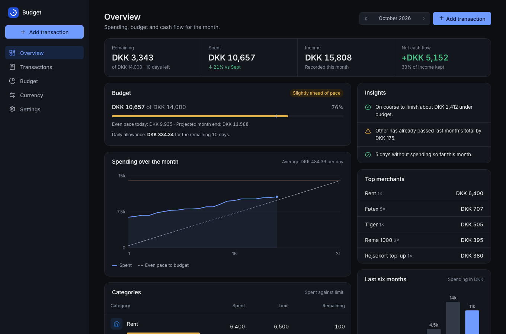
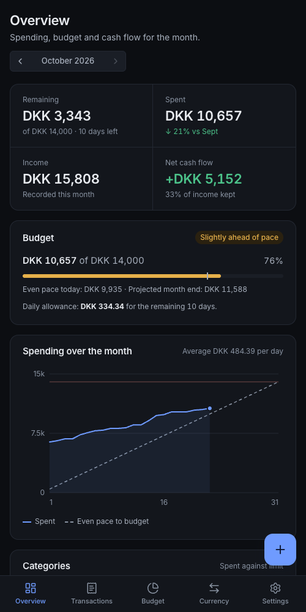
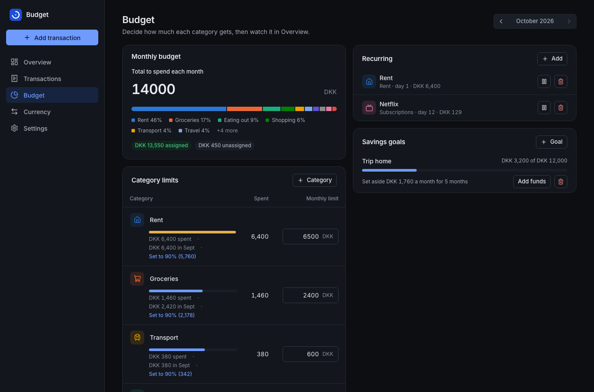

# Budget Tracker

A self-hosted personal-finance app, built and operated end to end: a React + TypeScript progressive web app, a
dependency-light Node API, and the infrastructure and delivery pipeline that runs it at
[budget.atharvvadehra.dev](https://budget.atharvvadehra.dev) from a Proxmox homelab.

I built it to cut my own spending while living in Denmark and sending money to India, so it tracks **DKK and INR**
with the daily ECB rate, turns a monthly budget into a **safe-to-spend-per-day** number, and logs purchases
automatically from an iPhone through Apple Pay and Shortcuts.



<p>
  
  
</p>

*Screenshots use generated demo data (`npm run seed:demo`).*

## What this project demonstrates

| Area | What is in the repo |
|---|---|
| **Full-stack engineering** | React 19, TypeScript, Vite, TanStack Query and React Router on the front end. A hand-written Node 24 HTTP server on `node:sqlite` with one runtime dependency (`web-push`). |
| **Product thinking** | Quick entry in one line (`120 netto groceries`), budget pace and projected month end, insights, recurring items, goals, two currencies where every transaction stores the rate it was recorded at. |
| **Security** | A written [audit](SECURITY-AUDIT.md) with 14 findings fixed (CSRF origin check, stored-markup injection, CSV formula injection, SSRF through push endpoints, DNS rebinding, throttling). Strict CSP, hashed server-side sessions, non-root read-only container. |
| **Testing** | 41 API, auth, security, proxy and static-serving tests that start the real server, plus 29 web unit tests. All run in CI on every pull request. |
| **CI/CD** | GitHub Actions: type check, tests, build, `npm audit`, dependency review, CodeQL, Docker smoke test, SBOM and provenance. Deploys run over Tailscale SSH with a health check and automatic rollback. |
| **Infrastructure as code** | The server is created by Terraform in a [separate repo](https://github.com/vadehraatharv7-hub/homelab): Proxmox LXC, Cloudflare Tunnel and bootstrap of the app, with a nightly Proxmox backup on top. |
| **Frontend craft** | A small design system (tokens, primitives), accessible native `<dialog>`s, SVG charts drawn at measured width, light and dark themes, an offline entry queue, and mobile fixes (no zoom-on-focus, no horizontal scroll). |

Deeper reading: **[Architecture and design decisions](docs/ARCHITECTURE.md)** · [Hosting and CI/CD](docs/DEPLOY.md) · [Security audit](SECURITY-AUDIT.md).

## Tech stack

`TypeScript` `React 19` `Vite` `TanStack Query` `Node 24` `SQLite (WAL)` `Web Push / VAPID` `WebAuthn` `Service Worker`
`Docker` `GitHub Actions` `Terraform` `Proxmox` `Cloudflare Tunnel` `Tailscale`

## Run it

```bash
docker compose up -d --build        # then open http://<server-ip>:3000
```

or without Docker:

```bash
npm install
npm run build                       # builds the web app into dist/
APP_PASSWORD=secret npm start
```

| Variable | Default | Purpose |
|---|---|---|
| `PORT` | `3000` | HTTP port |
| `APP_PASSWORD` | *(none)* | Password for the web UI. **Set it** if anything beyond your LAN can reach the app |
| `DB_PATH` | `./data/budget.db` | SQLite file |
| `TRUST_PROXY` | *(off)* | `1` behind a reverse proxy (client IP from X-Forwarded-For); `cloudflare` behind Cloudflare Tunnel (client IP from CF-Connecting-IP) |
| `HOST` | `0.0.0.0` | Address to listen on; use `127.0.0.1` when only a local tunnel/proxy should reach the app |
| `LOGIN_MAX_FAILURES` / `LOGIN_WINDOW_SECONDS` | `8` / `900` | Failed logins inside the window that lock an IP out (for the window); a success resets the count |
| `ALLOWED_HOSTS` | *(any)* | Comma-separated hostnames; other `Host` headers get 421 (DNS-rebinding defence) |
| `TZ` | system | Time zone for "today", reminders, recurring items |
| `VAPID_SUBJECT` | `mailto:budget@example.com` | Contact used for web push |

Try it with sample data: `DB_PATH=./data/demo.db npm run seed:demo && DB_PATH=./data/demo.db npm start`.

## HTTPS is required for install + push

Service workers and push notifications only work on **HTTPS** (or `localhost`). On iOS, push also requires the app to be
**added to the Home Screen** (iOS 16.4+). Easiest options for a homelab:

- **Cloudflare Tunnel** (what this project's Terraform sets up): `cloudflared` makes an outbound connection, Cloudflare serves HTTPS on your domain, and you open no router ports. Run the app with `HOST=127.0.0.1` and `TRUST_PROXY=cloudflare`. Setup: [docs/DEPLOY.md](docs/DEPLOY.md).
- **Tailscale**: `tailscale serve --bg 3000` gives `https://<machine>.<tailnet>.ts.net` with a real certificate, reachable only from your own devices.
- **Caddy / Traefik / Nginx Proxy Manager** in front, with a domain and Let's Encrypt.

Then on iPhone: Safari → Share → **Add to Home Screen** → open it from the Home Screen → Settings → **Enable on this device**.

## iPhone Shortcuts

Settings → *iPhone Shortcuts* shows your server address and **API token**. Endpoints (header `Authorization: Bearer <token>`):

| Method | Path | Body |
|---|---|---|
| `POST` | `/api/shortcuts/expense` | `{"amount":"45,5","currency":"DKK","category":"groceries","note":"Netto"}` (`currency`, `category`, `note`, `date` optional; category matches by name/prefix) |
| `GET` | `/api/shortcuts/categories` | → `{"categories":[...]}` for a *Choose from List* |
| `GET` | `/api/shortcuts/summary` | → `{"message":"…"}` ("how am I doing?") |

Build the shortcut: **Ask for Input** (Number) → **Choose from List** → **Get Contents of URL** (POST, JSON, header above) → **Get Dictionary Value** `message` → **Show Result**.
Then trigger it from Siri, the Action Button, Back Tap, or the home screen.
**Fully automatic:** Shortcuts → Automation → **Transaction** (Apple Pay) → run the shortcut with *Amount* and *Merchant* → every tap-to-pay is logged without opening anything.

## Features

- **Transactions**: quick entry (type `120 netto groceries` or `₹450 auto`), frequent categories first, remembered merchant-to-category, edit and delete, search and filters, CSV and JSON export, bank CSV import.
- **Budgeting**: a monthly total, per-category limits, spend against limit with 75% and 100% thresholds, an even-pace marker, projected month end and a daily allowance; recurring items; savings goals with a monthly target.
- **Reporting**: cash flow (income, spending, net), spending over the month, six-month history, insights and top merchants.
- **Two currencies**: DKK and INR with the daily ECB rate, history and a manual override; every transaction keeps the rate it was recorded at.
- **Security**: password, app lock (6-digit PIN with optional Face ID or Touch ID), strict CSP, request throttling.
- **Everywhere**: installable PWA, push alerts, offline entry queue, iOS Shortcuts API, responsive from phone to widescreen, light and dark.

## CI/CD

GitHub Actions runs tests, CodeQL, dependency audit and a Docker smoke test on every PR, and deploys `main` to a Proxmox LXC over Tailscale SSH. The app itself is published to the internet with a Cloudflare Tunnel. Setup and threat model: [docs/DEPLOY.md](docs/DEPLOY.md). `npm test` runs the same suite locally.

## Security notes

Password (HMAC-signed HttpOnly cookie, login throttling), separate API token for Shortcuts, strict CSP, no third-party scripts or
trackers (the only outbound call is the daily exchange-rate fetch from the server). Everything is stored on your server.
**App lock** (Settings): 6-digit PIN (PBKDF2, throttled after 5 wrong tries) plus optional Face ID / Touch ID via WebAuthn, verified locally; locks on launch and after the delay you choose. It guards against someone picking up your unlocked device — it is per-device and doesn't encrypt server data, so also put the `data` volume on an encrypted disk. Needs HTTPS (or localhost).

See [SECURITY-AUDIT.md](SECURITY-AUDIT.md) for the full audit, fixes and residual risks.

## Development

```bash
npm install
npm run dev          # API on :3000 (restarts on change)
npm run dev:web      # web app on :5173 with hot reload, proxying /api to :3000
npm run check        # server syntax + TypeScript
npm test             # server tests (41)     npm run test:web   # web unit tests
npm run build        # production build into dist/
```

```
server/   index.js (API + static)  db.js  rates.js  summary.js  push.js  scheduler.js
web/      index.html  vite.config.ts  public/ (manifest, service worker, icons)
  src/    main.tsx  App.tsx  routes/ (Overview, Transactions, Budget, Currency, Settings, Login)
          components/ (shell, dialogs, charts)  hooks/  lib/ (api, money, dates, lock, push, parseQuick, ...)
          styles/ (tokens, base, ui, layout)
test/     API, auth, security, proxy, throttling and static-serving tests
scripts/  make-icons.js  seed-demo.js
```

The design system lives in `web/src/styles/`: colour and spacing tokens (`tokens.css`), shared primitives (`ui.css`) and page layout
(`layout.css`). Colour is reserved for status and data; the rest of the UI is neutral with a single accent.
