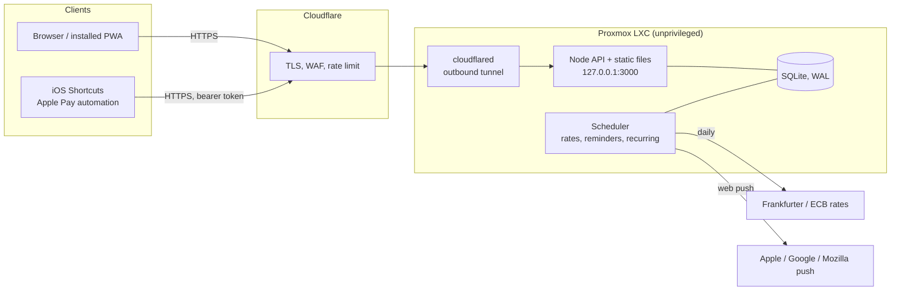
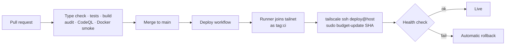

# Architecture and design decisions

This page explains how Budget Tracker is put together and why. It is written for a reviewer who wants to judge the
engineering, not just run the app.

## System overview

One process serves both the JSON API and the built web app. State lives in one SQLite file, so a backup is a file copy.

## Backend (`server/`)

| File | Responsibility |
|---|---|
| `index.js` | HTTP router, sessions, Origin check, throttling, static serving with SPA fallback, all API routes |
| `db.js` | Schema, settings, seeded categories, input sanitisers (`cleanColor`, `cleanIcon`, `cleanText`), startup migrations |
| `summary.js` | Month summary: category totals, projection, daily allowance, pace, insights |
| `rates.js` | ECB rates with history, fallback provider, manual override, `localDate` |
| `push.js` | VAPID setup, subscription storage with an endpoint allowlist, alert and reminder wording |
| `scheduler.js` | One-minute tick: daily rate refresh, recurring items, reminder and weekly recap sent once per day |

### Decisions

- **Almost no dependencies.** The only runtime dependency is `web-push`. Routing is about a hundred lines on
  `node:http`, and storage uses the `node:sqlite` module built into Node. Fewer packages means a smaller attack surface,
  a clean `npm audit`, and nothing to break on upgrade. The cost is writing a little plumbing, which is acceptable at
  this size.
- **SQLite in WAL mode.** One user and one writer. It removes a database server to run, patch and back up.
- **Money keeps its history.** Every transaction stores the original amount, its currency, the rate at that time, and the
  amount in the base currency. Reports sum the stored base amount, so changing today's rate never rewrites the past.
- **Server-side sessions.** The cookie holds a random token. The database stores only its hash, with a 90-day expiry, so
  a leaked database cannot be replayed and sessions can be revoked.
- **The scheduler dedupes in the database.** Reminders and threshold alerts write a key (`daily:2026-10-22`,
  `cat:3:2026-10:100`) with `INSERT OR IGNORE`. A restart in the middle of the day cannot send a second notification.
- **Projection that avoids false alarms.** A category is extrapolated only when it has at least four purchases, so a
  single rent payment is not projected into a ten-times overspend.

## Frontend (`web/`)

React 19 and TypeScript, built by Vite into `dist/`, which the server serves.

- **Routing and data.** React Router for pages. TanStack Query for server state, so screens share one cache and refetch
  after mutations.
- **Design system.** `styles/tokens.css` (colour, spacing, type), `ui.css` (primitives), `layout.css` (page structure).
  Colour is reserved for status and data. Everything else is neutral with one accent.
- **Charts are hand-built SVG** drawn at the measured container width (`useElementWidth`), with the maths in a tested
  helper (`chartMath`). There is no chart library to ship or restyle.
- **Dialogs use the native `<dialog>` element**, which gives focus trapping and Escape handling without a library.
- **Offline.** A service worker caches the shell with a network-first strategy and serves hashed assets as immutable.
  New entries made offline go into a queue in local storage and sync when the connection returns.
- **Mobile.** Inputs are 16px on touch devices so iOS does not zoom on focus. Grids use `minmax(0, 1fr)` and the page uses
  `overflow-x: clip` so nothing causes sideways scroll. A test (`styles/mobile.test.ts`) guards these rules.
- **Quick entry.** `parseQuick` turns `120 netto groceries` or `₹450 auto` into amount, currency, note and category, and the
  app remembers which category each merchant belongs to.

## Security model

The threat model: a single-user app on a public hostname, so strangers can reach the login page.

| Layer | Control |
|---|---|
| Edge | Cloudflare terminates TLS. The app listens on `127.0.0.1` only, and `cloudflared` connects outbound, so the router has no open ports. A Cloudflare rate limit on `/api/login` is written in Terraform but not applied yet. |
| Authentication | Password with server-side sessions. A failed-login counter per client IP locks out after 8 failures in 15 minutes and resets on success. The client IP comes from `CF-Connecting-IP` only when `TRUST_PROXY=cloudflare`. |
| Request integrity | Any non-GET request that carries an `Origin` header must match the host (CSRF). `ALLOWED_HOSTS` returns 421 for unknown `Host` headers (DNS rebinding). Bodies are capped at 1 MB. |
| Browser | Strict CSP (`script-src 'self'`, `frame-ancestors 'none'`), HSTS over HTTPS, `nosniff`, no third-party scripts. |
| Input handling | Categories accept only `#rrggbb` colours and slug icons. CSV export neutralises formula cells. Push endpoints must match an allowlist of real push services, which closes an SSRF route into the LAN. |
| Automation | iPhone Shortcuts use a separate 192-bit bearer token, throttled like the login. |
| Device | An optional app lock (PIN with PBKDF2 plus WebAuthn for Face ID) guards an unlocked phone. It is documented as a casual gate, not encryption. |
| Runtime | The container runs as a non-root user with a read-only filesystem, `cap_drop: ALL` and `no-new-privileges`. |

The full list of findings, fixes and accepted risks is in [SECURITY-AUDIT.md](../SECURITY-AUDIT.md).

## Testing

| Suite | Count | What it covers |
|---|---|---|
| `test/*.test.js` | 41 | Starts the real server against a temporary database. API behaviour, auth coverage on every route, security headers, proxy handling, login throttling, static serving including path traversal |
| `web/src/**/*.test.ts` | 29 | Money formatting, date helpers, quick-entry parser, chart maths, lock logic, mobile CSS rules |
| CI extras | | TypeScript check, `npm audit`, dependency review, CodeQL, Docker smoke test |

The server tests run against a real process rather than mocks, so they exercise routing, headers and cookies exactly as
production does.

## Delivery

- The deploy script builds into `dist.next`, swaps it into place, restarts the service and checks health. If the check
  fails it restores the previous build, so a bad commit does not take the site down.
- The runner holds no SSH key. It authenticates to Tailscale with a short-lived OAuth client, and the tailnet policy lets
  `tag:ci` reach the container on port 22 only, as the `deploy` user, who can run exactly one `sudo` command.
- Third-party actions are pinned to commit SHAs. Deploys stay off until `DEPLOY_ENABLED=true` is set.

Setup steps are in [DEPLOY.md](DEPLOY.md). The Terraform that builds the host is in the
[homelab repository](https://github.com/vadehraatharv7-hub/homelab).

## Trade-offs and what I would change

- **Single user.** One password and one API token keep the code small. Multiple users would need accounts, roles and
  per-user data.
- **Backups share the host's disk.** A nightly Proxmox backup exists and a restore was tested, but a disk failure would
  lose both. An off-host copy is the next step.
- **HTTPS depends on Cloudflare.** The app cannot be installed or send push without it.
- **No end-to-end encryption of stored data.** The database is plain SQLite, so the volume should sit on an encrypted disk.
- **The Cloudflare Access login wall is written but off.** The app's own throttle and the edge rate limit are enough for a
  personal tool, and Access would add friction to the Shortcuts automation.
